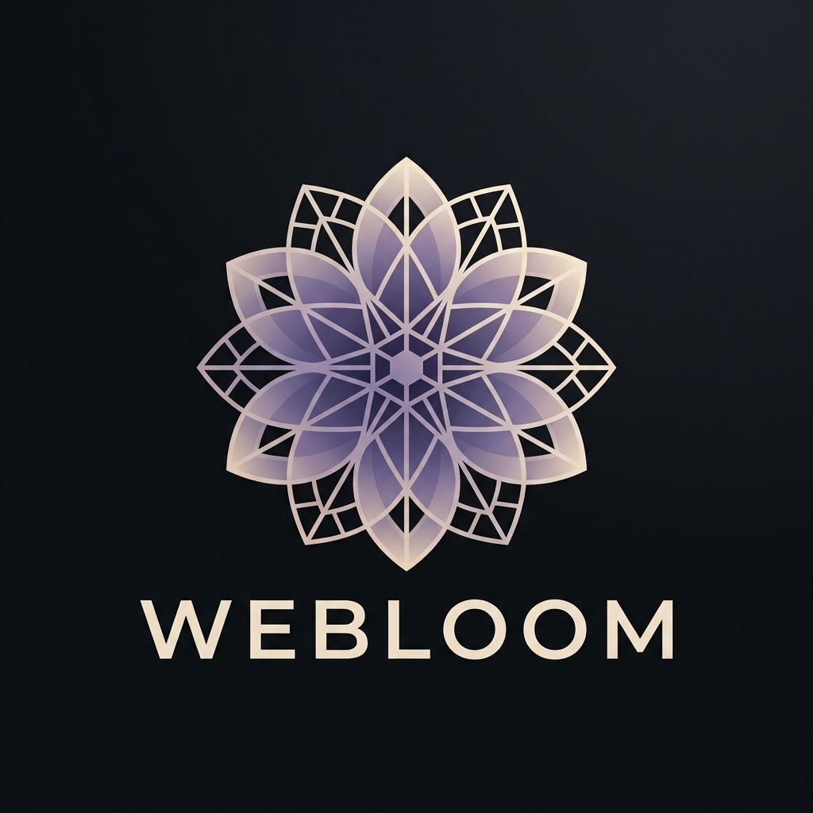
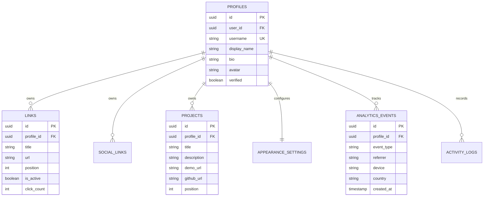

<div align="center">

  

  # 🌸 Webloom

  **Your corner of the internet. One link → everything about you.**

  An ultra-modern, production-ready portfolio and link-in-bio platform engineered for creators, designers, and developers. Think Linktree meets Bento with the design elegance of a personal boutique website.

  <br />

  [](https://nextjs.org/)
  [](https://react.dev/)
  [](https://www.typescriptlang.org/)
  [](https://tailwindcss.com/)
  [](https://supabase.com/)
  [](https://www.framer.com/motion/)

  <br />

  [Explore Features](#-key-features) • [Tech Stack](#-tech-stack) • [Getting Started](#-getting-started) • [Database Schema](#-database-architecture) • [Live Themes](#-13-artisan-theme-presets)

</div>

---

## ⚡ Highlights

- 🎨 **13 Curated Theme Presets**: From crisp Scandinavian *Minimal Light* to cybernetic *Neon Cyberpunk* and luxurious *Earthy Warmth*.
- 🤹 **Fluid Drag & Drop Reordering**: Powered by `@dnd-kit` with spring-loaded physical micro-interactions and tactile feedback.
- 💼 **Rich Project Showcases**: Display interactive portfolio cards with tags, descriptions, live demo links, and GitHub integration.
- 🌐 **13-Platform Social Icon Grid**: Native vector branding for GitHub, X, LinkedIn, Instagram, YouTube, Discord, TikTok, Spotify, and more.
- 📊 **Real-time Analytics Dashboard**: Interactive area & bar charts rendered with `Recharts` tracking page views, click telemetry, referrers, and device breakdowns.
- 📱 **QR Code Engine & Instant PNG Download**: Dynamic vector QR generator with one-click download for print or business cards.
- 🔐 **Production-Grade Supabase Auth & RLS**: 7 PostgreSQL relational tables guarded by strict Row Level Security policies.
- 👁️ **Synchronized Live Device Preview**: Live responsive canvas switching effortlessly between Mobile, Tablet, and Desktop viewpoints.

---

## 📸 Overview & Architecture

```
                                  🌸 WEBLOOM PLATFORM
                                           │
         ┌─────────────────────────────────┴─────────────────────────────────┐
         ▼                                                                   ▼
┌──────────────────┐                                               ┌──────────────────┐
│  PUBLIC PROFILE  │  webloom.site/@username                       │ ADMIN DASHBOARD  │
├──────────────────┤                                               ├──────────────────┤
│ • Dynamic Theme  │                                               │ • Link Reorder   │
│ • Social Matrix  │                                               │ • Theme Studio   │
│ • Project Cards  │                                               │ • Live Analytics │
│ • Click Tracing  │                                               │ • QR Generator   │
└────────┬─────────┘                                               └────────┬─────────┘
         │                                                                  │
         └─────────────────────────┬────────────────────────────────────────┘
                                   ▼
                   ┌──────────────────────────────┐
                   │    SUPABASE POSTGRESQL &     │
                   │      ROW LEVEL SECURITY      │
                   └──────────────────────────────┘
```

---

## 🎨 13 Artisan Theme Presets

Webloom comes pre-baked with curated design systems featuring tailored typography, custom border radii, and background treatments:

| Theme ID | Name | Aesthetic Description | Font Family |
| :--- | :--- | :--- | :--- |
| `minimal` | **Minimal Light** | Crisp, high-contrast modern Scandinavian aesthetic | Inter |
| `midnight` | **Midnight Dark** | Deep obsidian backdrop with glowing luminous accents | Geist |
| `sunset` | **Sunset Horizon** | Warm atmospheric dusk gradient with peach accents | Manrope |
| `emerald` | **Emerald Forest** | Rich moss & deep forest greens with organic warmth | DM Sans |
| `cyberpunk`| **Neon Cyberpunk** | High-voltage neon magenta and cyan cyberpunk palette | Space Grotesk |
| `lavender` | **Soft Lavender** | Gentle pastel lilac with dreamy glassmorphism | Plus Jakarta Sans |
| `retro` | **90s Retro Brutalism** | Hard shadow neo-brutalist borders with bold colors | Space Grotesk |
| `luxury` | **Onyx & Gold** | Premium gold foil accents against champagne black | Playfair Display |
| `earth` | **Earthy Warmth** | Terracotta, clay, and sand organic palette | Manrope |
| `nordic` | **Nordic Frost** | Icy slate blues with frozen glass translucency | Geist |
| `bubblegum`| **Pastel Pop** | Vibrant candy-coated playful gradients | Plus Jakarta Sans |
| `coffee` | **Espresso Café** | Deep roasted mocha and warm toasted caramel | DM Sans |
| `monochrome`| **Pure Mono** | Archival stark black-and-white editorial layout | Inter |

---

## 🛠️ Tech Stack

### Core Framework & State
- **Framework:** [Next.js 15 (App Router)](https://nextjs.org/)
- **UI Runtime:** [React 19](https://react.dev/)
- **Language:** [TypeScript 5](https://www.typescriptlang.org/)
- **Styling:** [Tailwind CSS 3.4](https://tailwindcss.com/) with custom tokens
- **Animations:** [Framer Motion 12](https://www.framer.com/motion/)

### Drag-and-Drop & Utilities
- **DnD Engine:** [`@dnd-kit/core`](https://dndkit.com/), `@dnd-kit/sortable`, `@dnd-kit/utilities`
- **Charts & Visualizations:** [`Recharts`](https://recharts.org/)
- **QR Codes:** [`qrcode`](https://www.npmjs.com/package/qrcode) with high-res PNG export
- **Icons:** [`lucide-react`](https://lucide.dev/) + Custom SVG Brand Matrix
- **Micro-Delights:** `canvas-confetti`

### Backend & Database
- **BaaS:** [Supabase](https://supabase.com/)
- **Database:** PostgreSQL with Row Level Security (RLS)
- **Auth:** Supabase Auth (`@supabase/ssr`, `@supabase/supabase-js`)
- **Storage:** Supabase Storage (S3-compatible bucket)

---

## 🗄️ Database Architecture

The schema features 7 relational tables with strict RLS policies:



---

## 🚀 Getting Started

### 1. Prerequisites
- **Node.js**: v18.18+ or v20+
- **pnpm** (recommended), **npm**, or **yarn**
- A **Supabase** project (free tier works great)

### 2. Clone the Repository
```bash
git clone https://github.com/YounusSyed186/Webloom.git
cd Webloom
```

### 3. Install Dependencies
```bash
pnpm install
# or
npm install
```

### 4. Configure Environment Variables
Create a `.env.local` file in the root directory:

```env
# Supabase Configuration
NEXT_PUBLIC_SUPABASE_URL=your_supabase_project_url
NEXT_PUBLIC_SUPABASE_ANON_KEY=your_supabase_anon_key

# Optional Custom Domain / Base URL
NEXT_PUBLIC_APP_URL=http://localhost:3000
```

### 5. Setup Database
Run the migration scripts located in the `supabase/` folder inside your Supabase SQL Editor:
1. Run `supabase/schema.sql` to initialize tables, indexes, and RLS policies.
2. (Optional) Run `supabase/seed.sql` to populate sample demo data for handle `younus`.

### 6. Start the Development Server
```bash
pnpm dev
# or
npm run dev
```

Open [http://localhost:3000](http://localhost:3000) in your browser to experience Webloom!

---

## 📁 Project Structure

```
├── docs/                      # Requirements, audits, and architectural evidence
├── public/                    # Static branding, images, and SVG icons
│   └── images/                # Logos, portraits, hero graphics
├── src/
│   ├── app/
│   │   ├── (auth)/            # Login, register, and password recovery
│   │   ├── [username]/        # Dynamic public profile routing (@username)
│   │   ├── dashboard/         # Creator management console
│   │   │   ├── links/         # Drag-and-drop link manager
│   │   │   ├── appearance/    # Real-time theme customizer
│   │   │   ├── projects/      # Project showcase editor
│   │   │   ├── analytics/     # Telemetry & charts view
│   │   │   └── settings/      # Account & custom domain settings
│   │   ├── api/               # Serverless route handlers (telemetry, uploads)
│   │   └── page.tsx           # Marketing landing page
│   ├── components/
│   │   ├── dashboard/         # Dashboard layout, navigation & live preview
│   │   ├── profile/           # Responsive public profile renderers
│   │   ├── sharing/           # QR code modal & share dialogs
│   │   └── ui/                # Buttons, dialogs, inputs, brand icons
│   ├── lib/
│   │   ├── themes.ts          # 13 theme definitions & CSS variables
│   │   ├── constants.ts       # Reserved handles & platform metadata
│   │   ├── data-store.ts      # Reactive state store & Supabase synchronization
│   │   └── supabase/          # Supabase client & SSR wrappers
│   └── types/                 # TypeScript interfaces and entity types
└── supabase/                  # SQL DDL schemas, security rules, and seed data
```

---

## 🤝 Contributing

Contributions are always welcome! Feel free to open an issue or submit a pull request:

1. Fork the Project
2. Create your Feature Branch (`git checkout -b feature/AmazingFeature`)
3. Commit your Changes (`git commit -m 'Add some AmazingFeature'`)
4. Push to the Branch (`git push origin feature/AmazingFeature`)
5. Open a Pull Request

---

## 📄 License

Distributed under the **MIT License**. See `LICENSE` for more information.

<div align="center">
  <sub>Engineered with care for the creators of the modern web.</sub>
</div>
