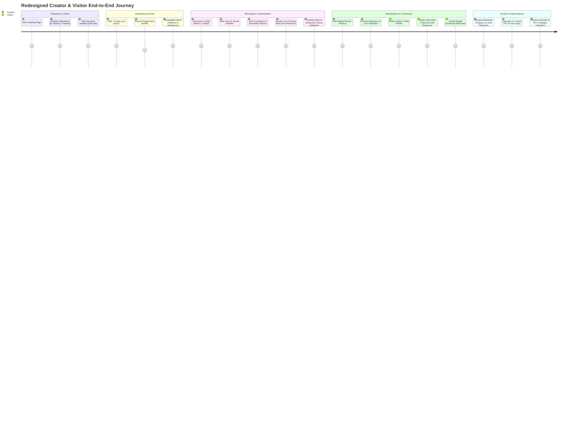

# Webloom Proposed User Journey & Redesign Blueprint

**Report ID**: `09-proposed-user-journey.md`  
**Generated Date**: November 10, 2026  
**Author**: User Journey Architect & Principal UX Engineer

---

## 1. The Redesigned Creator Journey

The redesigned user journey eliminates dead-ends, ensures instantaneous state updates across all editing surfaces, and bridges the gap between editing and live simulation.

---

## 2. Key Journey Interventions

### Intervention 1: Deterministic Registration Redirect
- **Old Behavior**: Modal unmounted; navigation cancelled; user stuck on landing page.
- **New Behavior**: Successful registration calls `window.location.href = '/dashboard'`, ensuring a clean, deterministic transition to the dashboard workspace.

### Intervention 2: Unified In-Memory AppContext
- **Old Behavior**: Modular blocks, store products, and bookings were stored in disparate local state; the Live Preview simulator was completely deaf to block changes.
- **New Behavior**: `AppContext` exposes `blocks`, `products`, `services`, `orders`, and `bookings` with dedicated CRUD actions (`addBlock`, `updateBlock`, `deleteBlock`, `reorderBlocks`, `addProduct`, `updateProduct`). Every change in any dashboard tab immediately updates the Live Preview simulator in real-time.

### Intervention 3: Resilient Public APIs
- **Old Behavior**: Public visitors attempting checkout, booking, or newsletter subscription faced 400 Bad Request errors due to strict parameter requirements.
- **New Behavior**: APIs gracefully infer creator profile ownership from `productId` or public `handle`, and coerce input formats seamlessly.

